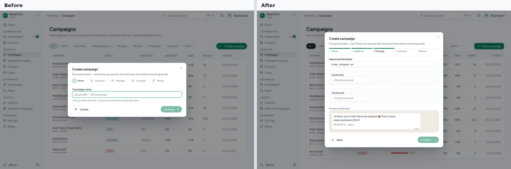
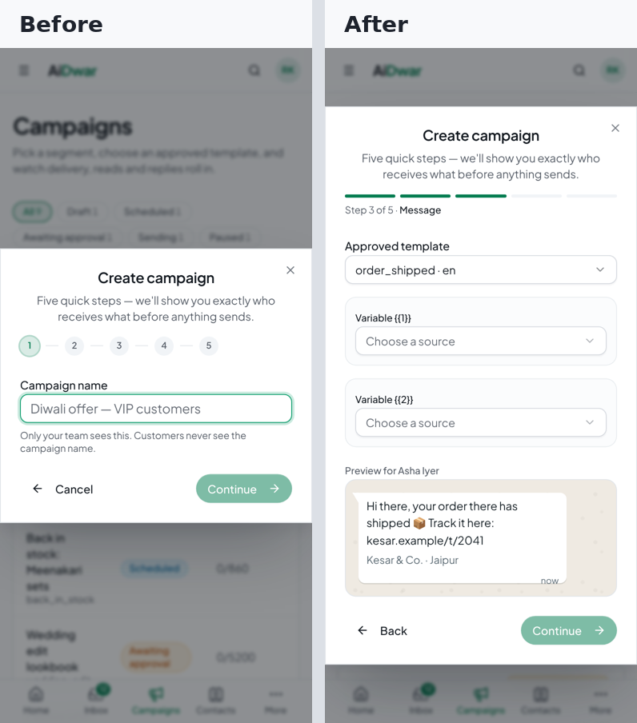
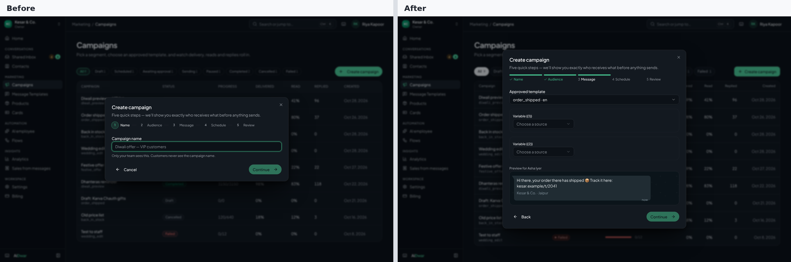
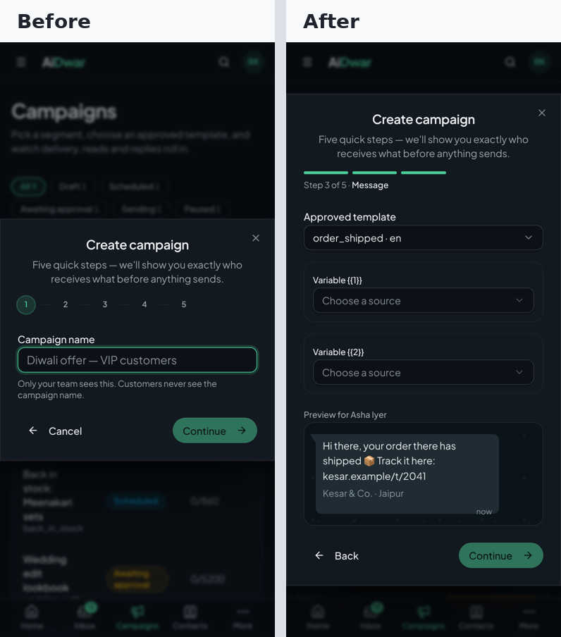

# Batch 41 — screenshots

Made with `scripts/ui-shots/shoot.mjs --set b41` (fake data, nothing live). Desktop 1440×900, phone 390×844. BEFORE is Batch 39 (PR #48): new shell and tokens, old pages.

## Before / after — light

### Home

### Campaigns — list

### Campaigns — empty

### Campaign detail

### New campaign wizard (Message step)

### Templates

### Templates — empty

### Create a template

## Before / after — dark

### Home

### Campaigns — list

### Campaigns — empty

### Campaign detail

### New campaign wizard (Message step)

### Templates

### Templates — empty

### Create a template

All raw files: [`before/`](before) · [`after/`](after) · [`compare/`](compare).
